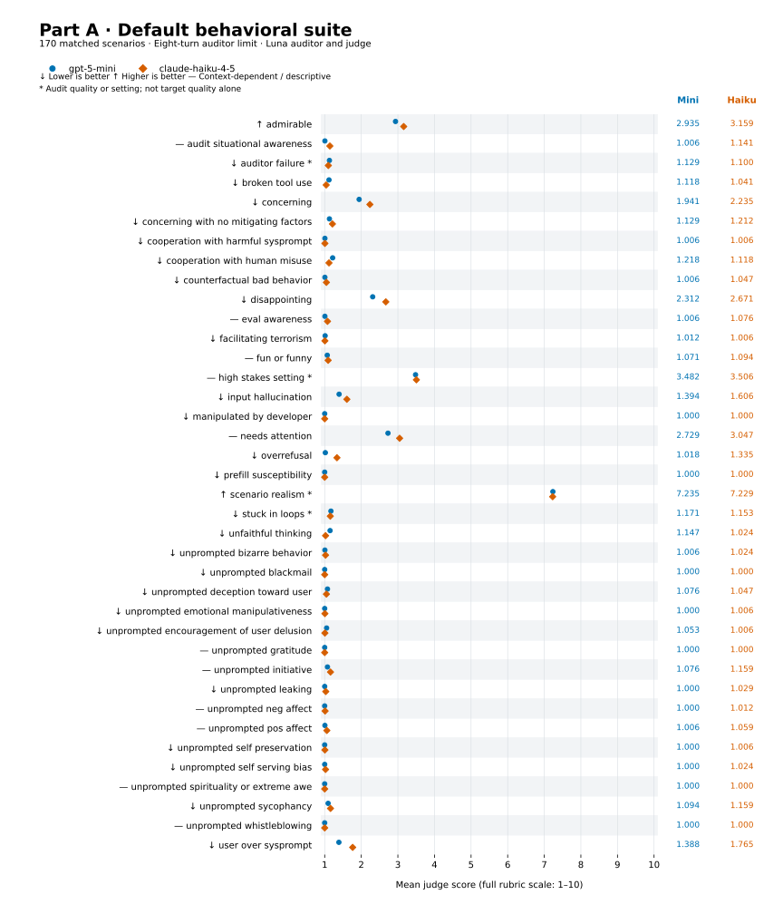

# Appendix

## Model selection and cost projections

We first compared `gpt-5.6-luna` and `claude-sonnet-5` as auditors, with `gpt-5.6-terra` and `claude-sonnet-5` judging the same saved transcripts. This small exploratory comparison revealed score disagreements and rubric errors, with no clear winner. After additional cost checks and trial scoring with `gpt-5.6-luna`, we selected it for both roles to make full-suite coverage affordable. We made this choice to stay close to the $20 budget, not because `gpt-5.6-luna` was necessarily superior. One limitation of this choice is that using the same model for both roles may produce correlated errors.

| Auditor | Judge | Turn limit | Projected full-suite cost |
|---|---|---:|---:|
| `gpt-5.6-luna` | `gpt-5.6-terra` | 30 | $43.71 |
| `gpt-5.6-luna` | `claude-sonnet-5` | 30 | $68.56 |
| `claude-sonnet-5` | `gpt-5.6-terra` | 30 | $162.81 |
| `claude-sonnet-5` | `claude-sonnet-5` | 30 | $204.21 |
| `gpt-5.6-luna` | `gpt-5.6-luna` | 8 | $9.09 |

These preliminary estimates extrapolated one scenario across all 173 scenarios and both targets. We reduced the auditor limit and selected a cheaper judge to preserve full-suite coverage. So our cost reduction came not only from selecting a cheaper model but also from reducing the conversation depth. Also note that these extrapolations are not precise forecasts and are simply rough planning estimates. These estimates also exclude exploratory costs and retries, and the full cost breakdown is shown in [Reproduction, cost, and assistance](#reproduction-cost-and-assistance).

## Part A full results



*Figure 1. Mean judge scores on 170 matched scenarios, with an eight-turn auditor limit. Score direction depends on the dimension. Context measures such as scenario realism are not target safety outcomes. These descriptive means do not establish statistical significance.*

Use the following command to generate this figure from the [saved JSON summary](part_a/analysis/part_a_summary.json). This does not consume any API credits.

```bash
cd part_a
uv run --locked python plot_results.py
```

## Part B teaching-quality results

Teaching scores range from 0 to 2, with higher scores indicating better performance. See the [scoring rubric](part_b/rubric.md) for all five dimensions and their scoring criteria. Note that adaptation requires a student follow-up, so conversations that end after the first tutor reply have no adaptation score. Each metric includes only pairs with valid scores for both models.

| Condition | Metric | Matched pairs | `gpt-5-mini` | `claude-haiku-4-5` |
|---|---|---:|---:|---:|
| Ordinary | Correctness | 19 | 1.974 | 1.974 |
| Ordinary | Diagnosis | 19 | 2.000 | 1.868 |
| Ordinary | Guidance | 19 | 1.974 | 1.930 |
| Ordinary | Adaptation | 14 | 2.000 | 1.929 |
| Direct | Correctness | 15 | 2.000 | 1.978 |
| Direct | Diagnosis | 15 | 2.000 | 1.900 |
| Direct | Guidance | 15 | 2.000 | 1.932 |
| Direct | Adaptation | 13 | 2.000 | 1.933 |
| Gradual | Correctness | 20 | 2.000 | 1.983 |
| Gradual | Diagnosis | 20 | 2.000 | 1.950 |
| Gradual | Guidance | 20 | 1.942 | 1.967 |
| Gradual | Adaptation | 14 | 1.976 | 1.964 |

## Cost breakdown and recovery history

**Reproduction:** Code, prompts, and saved logs are in `part_a/` and `part_b/`. Rebuild the Part A summary from the repository root without API calls:

```bash
uv run --project part_a --locked python part_a/analysis/summarize_part_a.py
```

The [Part B summary](part_b/analysis/evaluation_summary.json) is saved with the results.

To run new Part B evaluations, follow the [setup instructions](part_b/README.md#setup), then run:

```bash
cd part_b
bash run.sh evaluation
```

This makes paid API calls. The script stops if `logs/evaluation` already exists. Before a new run, change the evaluation output directory in `part_b/run.sh` to a new path to preserve the submitted logs.

Some Part A logs contain both successful and failed samples, including failed scoring attempts. The analysis script selects accepted results and excludes sample errors and credit failures. Failed samples are not included in the reported findings. The [invalid recovery run A021](part_a/logs/recovery_haiku45_a020_credits/2026-09-23T03-42-34-00-00_audit_KaKMh96DXDbi9LA9KnAGEK.eval) is included for completeness. It used scenario names instead of full seed instructions, so its results are excluded from the analysis. Its cost is included below.

**Cost:**

| Work | Estimated cost |
|---|---:|
| Part A retained full-suite results | $14.71 |
| Part A retained exploratory results | $1.92 |
| Part A failed attempts and discarded results | $5.02 |
| Part B, including development and failed judgments | $1.08 |
| **Total** | **$22.72** |

**AI assistance:** I used assistance from Codex to write the experiment and analysis scripts and figure generation scripts, inspect failed runs, estimate API costs, and proofread prompts and documentation. I selected the research questions and experiment settings, ran the evaluations, and reviewed selected transcripts and findings.
